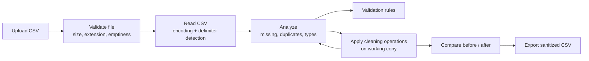

<div align="center">

# Data Quality Checker

**Upload a CSV. Find what is wrong with it. Clean it safely. Export the result.**

A Flask web application that profiles tabular data for missing values, duplicates, type anomalies and rule violations, then applies non-destructive cleaning on a working copy with a full audit trail.

<br>

[](https://data-quality-checker-93bf.onrender.com/)
[](https://github.com/IshanBiswas2006/Data-Quality-Checker)


[](LICENSE)

[Live Demo](https://data-quality-checker-93bf.onrender.com/) &nbsp;·&nbsp;
[Features](#features) &nbsp;·&nbsp;
[How It Works](#how-it-works) &nbsp;·&nbsp;
[Quick Start](#quick-start) &nbsp;·&nbsp;
[Configuration](#configuration) &nbsp;·&nbsp;
[Deployment](#deployment) &nbsp;·&nbsp;
[Testing](#testing)

</div>

---

## Overview

Bad data quietly breaks analyses and models. Data Quality Checker gives you a fast, visual way to see what is wrong with a CSV before you use it, and a safe way to fix it:

- **Inspect** a dataset for missing values, exact duplicate rows, inconsistent column types and custom rule violations.
- **Clean** on a separate working copy. The original upload is never mutated, and you can reset at any time.
- **Compare** before-and-after metrics, review the audit log of every operation, and **export** the cleaned CSV.

> **Try it:** open the [live demo](https://data-quality-checker-93bf.onrender.com/), create a free account, and click **Load Sample E-commerce CSV** on the upload page to see a full analysis without preparing a file.

---

## Features

| Area | What you get |
| --- | --- |
| **Upload** | `.csv` only, up to 16 MB (configurable). Encoding fallback across `utf-8`, `utf-8-sig`, `latin-1`, `cp1252`. Delimiter auto-detection for comma, semicolon, tab and pipe. Rejects empty, unreadable and malformed files. |
| **Preview** | Row, column and cell counts, column names, inferred types, and a capped sample of records. |
| **Missing values** | Per-column counts and percentages, overall null rate, and sample affected row numbers. |
| **Duplicates** | Exact-match duplicate detection with sample duplicated rows and a plain-language rule explanation. |
| **Type profiling** | Semantic inference (Integer, Decimal, Datetime, Boolean, Text) and detection of non-conforming values, such as text in a numeric column. |
| **Validation rules** | Required fields, numeric ranges (for example `Age >= 0`, `Price > 0`), email format and date format, with exact row numbers, failing values and reasons. Suggested rules are generated from column names and contents. |
| **Cleaning** | Remove duplicates, delete rows with missing values (any or all columns), impute missing values (constant, mean, median, mode), convert column types (integer, decimal, datetime, boolean, string), trim whitespace, drop columns. |
| **Safety** | Cleaning runs on a working copy, with confirmation before destructive actions and one-click reset to the original. |
| **Comparison and export** | Before-and-after metrics, charts rendered with Matplotlib, an audit trail of operations, and CSV export with formula-injection (DDE) sanitization. |
| **Accounts** | Sign up and log in, edit your profile (name, bio, email, avatar color), change your password, and keep a saved history of analyses. |
| **UI** | Drag-and-drop upload, tabbed results dashboard, light and dark themes, FAQ, About, Privacy and Terms pages. |

---

## How It Works



1. **Upload.** The file is checked for extension and size, rate-limited per client IP, then parsed with encoding and delimiter fallbacks.
2. **Analyze.** The dataset is held in a temporary in-memory session (expires after 2 hours by default) and profiled for missing values, duplicates and types.
3. **Clean.** Operations are applied to a copy derived from the original, and each one is recorded in the audit trail. Reset restores the original at any point.
4. **Export.** The cleaned dataset is downloaded as a CSV with formula-injection protection.

> **Note:** Uploading and analyzing a file requires a signed-in account. The home page, About, FAQ, Privacy and Terms pages are public.

---

## Tech Stack

| Layer | Technology |
| --- | --- |
| Language | Python 3.10+ |
| Web framework | Flask 3.1+ (application factory, blueprints) |
| Data processing | pandas 2.2+, NumPy 2.0+ |
| Charts | Matplotlib 3.9+ (server-side, `Agg` backend) |
| Storage | SQLite for user accounts, in-memory store for analysis sessions |
| Auth and security | `werkzeug.security` password hashing, CSRF tokens, Cloudflare Turnstile, security headers |
| Frontend | Jinja2 templates, vanilla JavaScript, token-based CSS |
| Testing | pytest |
| Serving | Gunicorn (Linux and PaaS), Waitress (Windows) |
| Hosting | Render |

---

## Project Structure

```text
.
├── app.py                  # Development entry point
├── wsgi.py                 # Production WSGI entry point
├── config.py               # Dev / Testing / Production configuration
├── render.yaml             # Render service definition
├── Procfile                # Process definition for PaaS platforms
├── requirements.txt
├── .env.example
├── app/
│   ├── __init__.py         # App factory, auth context, security headers, error handlers
│   ├── routes/
│   │   ├── main.py         # Home, About, FAQ, Privacy, Terms, /health, robots.txt, sitemap.xml
│   │   ├── auth.py         # Sign up, login, logout, profile, password, saved analyses
│   │   ├── upload.py       # Upload, validation, rate limiting
│   │   ├── analysis.py     # Results dashboard, re-analysis, validation rules
│   │   ├── cleaning.py     # Cleaning operations and reset
│   │   └── download.py     # Cleaned CSV export
│   ├── services/
│   │   ├── file_validator.py     # Size / extension / empty-file checks
│   │   ├── csv_reader.py         # Encoding- and delimiter-aware reader
│   │   ├── quality_analyzer.py   # Missing, duplicate and type analysis
│   │   ├── validation_rules.py   # Rule engine and suggested rules
│   │   ├── cleaning_service.py   # Non-destructive cleaning pipeline
│   │   ├── report_service.py     # Before/after metrics and charts
│   │   ├── export_service.py     # Safe CSV export
│   │   ├── session_store.py      # Temporary in-memory sessions
│   │   ├── rate_limiter.py       # Sliding-window, per-IP limiter
│   │   ├── user_service.py       # SQLite-backed users and profiles
│   │   └── turnstile_service.py  # Cloudflare Turnstile verification
│   ├── templates/          # Jinja2 pages, auth views, error pages (400/404/413/500)
│   └── static/             # CSS and JavaScript (main, upload, results)
├── tests/                  # pytest suite and CSV fixtures
└── examples/
    └── sample_sales.csv    # Example dataset
```

---

## Quick Start

**Requirements:** Python 3.10 or newer and Git.

```bash
# 1. Clone
git clone https://github.com/IshanBiswas2006/Data-Quality-Checker.git
cd Data-Quality-Checker

# 2. Create and activate a virtual environment
python3 -m venv .venv
source .venv/bin/activate          # Windows: .venv\Scripts\activate

# 3. Install dependencies
pip install -r requirements.txt

# 4. (Optional) copy the example environment file
cp .env.example .env               # Windows: copy .env.example .env

# 5. Run the development server
python app.py
```

Open <http://127.0.0.1:5000>, create an account, then upload `examples/sample_sales.csv` or use **Load Sample E-commerce CSV**.

---

## Configuration

Settings are read from environment variables, or from a `.env` file in the project root (loaded automatically by `config.py`). Real environment variables take precedence over `.env`.

| Variable | Default | Description |
| --- | --- | --- |
| `SECRET_KEY` | built-in development value | Signs session cookies. **Set a strong random value in production.** |
| `MAX_CONTENT_LENGTH` | `16777216` (16 MB) | Maximum upload size in bytes. |
| `UPLOAD_FOLDER` | `temp_uploads` | Temporary upload directory (created on startup). |
| `USERS_DB_PATH` | `instance/users.db` | SQLite database file for user accounts. |
| `PREVIEW_ROWS` | `10` | Rows shown in dataset previews. |
| `MAX_INSPECT_ROWS` | `50` | Cap on sample rows shown for inspection results. |
| `SESSION_MAX_AGE_SECONDS` | `7200` | Lifetime of in-memory analysis sessions. |
| `SESSION_COOKIE_SECURE` | `0` | Set to `1` to mark cookies HTTPS-only. Always on in the production config. |
| `CLOUDFLARE_TURNSTILE_ENABLED` | `true` | Toggle the CAPTCHA on sign up and login. |
| `CLOUDFLARE_TURNSTILE_SITE_KEY` | Cloudflare test key | Turnstile site key. |
| `CLOUDFLARE_TURNSTILE_SECRET_KEY` | Cloudflare test key | Turnstile secret key. Never commit a real key. |
| `FLASK_ENV` | `production` (in `wsgi.py`) | Selects the config profile: `development`, `testing` or `production`. |

The Turnstile defaults are Cloudflare's public testing keys, which are suitable for local development only. Register your own site with Cloudflare for real bot protection.

---

## Deployment

The live demo runs on [Render](https://render.com) using the included [`render.yaml`](render.yaml):

| Setting | Value |
| --- | --- |
| Runtime | Python, free plan |
| Build command | `pip install -r requirements.txt` |
| Start command | `gunicorn wsgi:app` |
| Health check | `/health` |
| Generated secret | `SECRET_KEY` |
| Preset variables | `FLASK_ENV=production`, `SESSION_COOKIE_SECURE=1`, `CLOUDFLARE_TURNSTILE_ENABLED=true` |
| Set in dashboard | `CLOUDFLARE_TURNSTILE_SITE_KEY`, `CLOUDFLARE_TURNSTILE_SECRET_KEY` |

**Other ways to run in production**

```bash
# Linux, containers, most PaaS (Procfile: web: gunicorn wsgi:app)
gunicorn wsgi:app

# Windows
waitress-serve --port=5000 wsgi:app
```

> **Free-tier note:** Render's free plan may sleep an idle service, so the first request can be slow. Analysis sessions live in process memory and the SQLite database lives on the instance filesystem, so both are lost on restart unless you attach persistent storage.

---

## Security

- **Passwords** are hashed with `werkzeug.security` (salted).
- **Cookies** are `HttpOnly` and `SameSite=Lax`, and `Secure` in production.
- **Headers:** `Content-Security-Policy`, `X-Content-Type-Options: nosniff`, `X-Frame-Options: SAMEORIGIN`, `X-XSS-Protection`, and `Referrer-Policy: strict-origin-when-cross-origin`.
- **Forms:** CSRF tokens on authentication forms, plus Cloudflare Turnstile on sign up and login.
- **Uploads:** extension, size and emptiness checks, safe parsing, and a per-IP sliding-window rate limit (40 uploads per 10 minutes).
- **Exports:** cells that could be interpreted as spreadsheet formulas are sanitized to prevent DDE and CSV injection.
- **Original data** is never modified; all cleaning happens on a working copy.

To report a vulnerability, please open a GitHub issue or contact the maintainer through their [GitHub profile](https://github.com/IshanBiswas2006).

---

## Testing

```bash
pytest -v
```

The suite contains **62 tests** covering file validation, quality analysis, validation rules, cleaning operations, export sanitization, authentication and profiles, routes, and security behavior (headers, rate limiting, error pages). Fixture CSVs live in [`tests/fixtures`](tests/fixtures).

---

## Contributing

Contributions are welcome.

1. Fork the repository and create a branch: `git checkout -b feature/your-change`
2. Make your change and add or update tests.
3. Run `pytest -v` and make sure everything passes.
4. Open a pull request describing what changed and why.

For bugs and ideas, please [open an issue](https://github.com/IshanBiswas2006/Data-Quality-Checker/issues).

---

## License

Released under the [MIT License](LICENSE).

<div align="center">

<sub>Built with Flask and pandas by <a href="https://github.com/IshanBiswas2006">Ishan Biswas</a></sub>

</div>